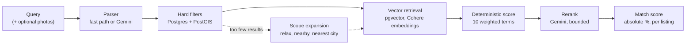

# ingovo-search

Natural-language property search for Hungarian real estate: type what you want the way you would say it, get listings ranked by fit, each with an honest match percentage.

[](https://github.com/Brok3nnn/ingovo-search/actions/workflows/ci.yml)
[](LICENSE)
[](pyproject.toml)

## Overview

Ingovo is a Hungarian property marketplace built around AI search. A buyer does not fill in a form of filters; they write a sentence, and the search works out the hard constraints (where, how much, how big, what kind), the softer wishes (quiet street, balcony, near a metro), and how well each listing satisfies them.

This repository is that search engine, extracted from the larger product as a standalone Python service. It contains the query parser, the PostGIS hard filters, the pgvector retrieval and scoring, the LLM rerank, the match-percentage model, the FastAPI endpoints, a CLI, a seedable demo database, the offline test suite and the eval harness. The marketplace around it (listing management, accounts, the web app) is not included.

## Example queries

The product is Hungarian, so the parser, its prompts and the test cases are Hungarian. English queries work too (`--locale en`).

| Query | In English |
|---|---|
| `téglalakás Budán 80 millió alatt, erkéllyel` | a brick flat in Buda under 80 million HUF, with a balcony |
| `2 szobás lakás a 13. kerületben 60 millióig` | a 2-room flat in the 13th district, up to 60 million HUF |
| `csendes családi ház kerttel Debrecen környékén` | a quiet family house with a garden around Debrecen |
| `kiadó garzon Budapesten 250 ezer alatt` | a studio flat to rent in Budapest under 250,000 HUF a month |
| `lakás a Deák Ferenc tér 2 kilométeres körzetében` | a flat within 2 km of Deák Ferenc tér |
| `eladó ház, de nem a 8. kerületben, iskola legyen a közelben` | a house for sale, not in the 8th district, with a school nearby |

What the parser makes of the first one, offline (no keys, no database):

```console
$ uv run ingovo-search --offline "téglalakás Budán 80 millió alatt, erkéllyel"
parsed query:
{
  "hard_filters": {
    "city": "Budapest",
    "transaction_type": "sale",
    "property_type_in": ["Lakás"],
    "price_huf_max": 80000000
  },
  "semantic_query": "téglalakás Budán 80 millió alatt, erkéllyel"
}
```

That is the deterministic fallback parser. The Gemini parser also reads "Budán" as the Buda side of the river (`geo_hints.side_of_river`) and "erkéllyel" as the `balcony` soft preference.

## Architecture



One request (`POST /api/search`) runs [`search/request.py`](src/ingovo_search/search/request.py) around the pipeline in [`search/pipeline.py`](src/ingovo_search/search/pipeline.py), one function per stage. `POST /api/search/stream` runs the same search and streams its progress as NDJSON events.

## How each stage works

**1. Parser** ([`recommender/parser.py`](src/ingovo_search/recommender/parser.py), schema in [`parser_schema.py`](src/ingovo_search/recommender/parser_schema.py)). The sentence becomes a `ParsedQuery`: hard filters (city, districts, property types, transaction, price, area, rooms, floor, a point and radius), anchors ("around 80 million"), soft preferences from a fixed vocabulary, free-text wishes, points of interest ("near a school"), geographic hints and a semantic query. Order of attempts: a Redis cache keyed on the normalised sentence and the prompt version; a deterministic fast path ([`parser_fastpath.py`](src/ingovo_search/recommender/parser_fastpath.py)) for simple queries, with no model call at all; otherwise Gemini 2.5 Flash-Lite with a structured-output schema and one correction retry. Deterministic post-processing then fixes what the model tends to miss: Budapest district mentions, negations ("nem a 8. kerületben", not in the 8th district), and settlement names resolved against the bundled KSH/GeoNames registry ([`settlements.py`](src/ingovo_search/recommender/settlements.py)). A parser timeout (2.5 s) falls back to the deterministic parse. Attached photos are read by Gemini vision concurrently with the parser and only ever add soft signal ([`image_query.py`](src/ingovo_search/recommender/image_query.py)).

**2. Hard filters** ([`recommender/sql_filter.py`](src/ingovo_search/recommender/sql_filter.py)). The hard filters become one parameterised SQL `WHERE` clause over `properties`: only active, unexpired listings; city and district strictly; categorical filters keep rows with unknown values for later scoring; numeric bounds drop rows that cannot be verified; room counts compare a generated numeric column (`ingovo_room_count`, [`db/schema.sql`](src/ingovo_search/db/schema.sql)); a point-and-radius request uses PostGIS `ST_DWithin`. When the strict pool is thin, [`search/candidates.py`](src/ingovo_search/search/candidates.py) expands the scope step by step (relaxed filters, then neighbouring settlements and districts, then the nearest city with inventory) and says so in the response (`relaxed`, `relaxation_path`).

**3. Vector retrieval and scoring** ([`recommender/recommend.py`](src/ingovo_search/recommender/recommend.py), [`score.py`](src/ingovo_search/recommender/score.py)). Every listing has two Cohere `embed-multilingual-v3.0` vectors (1024 dimensions) in pgvector: a factual one from a template over the structured fields and a descriptive one from the description ([`ingestion/build_factual_text.py`](src/ingovo_search/ingestion/build_factual_text.py)). The query is embedded once. If the filtered pool exceeds 500 listings, a cosine kNN over the factual vectors keeps the 500 nearest (HNSW indexes serve the unfiltered browse case); then every candidate gets a deterministic score from ten weighted terms: content and factual similarity, core and free-text preference matches, anchor closeness, listing quality, geography (including distance to the requested points of interest), pooled feedback from similar past queries, recency and a small exploration term. The weights are versioned and were calibrated by an nDCG grid search ([`eval/run_calibration.py`](eval/run_calibration.py)). All candidate data is fetched in batched queries; there is no per-listing round trip.

**4. Rerank** ([`search/reranking.py`](src/ingovo_search/search/reranking.py), [`recommender/rerank.py`](src/ingovo_search/recommender/rerank.py)). Gemini reorders the top 12 and writes a one-line Hungarian rationale per listing (or ranks only, with `AI_SEARCH_RERANK_RANK_ONLY`). It is skipped when it cannot help: no semantic content, or a simple query whose deterministic top is a clear winner. Guardrails in [`ranking_guardrails.py`](src/ingovo_search/recommender/ranking_guardrails.py) check that the reranker returned exactly the candidates it was given (no listing outside the hard filters can appear) and clamp any move beyond 10 positions. A timeout (3.5 s) or a malformed answer serves the deterministic order. An optional second reranker, TypeSafe's Jev model ([`rerank_jev.py`](src/ingovo_search/recommender/rerank_jev.py)), can serve instead, in a canary share of sessions, or in shadow mode next to Gemini, with automatic fallback to Gemini and a cooldown after failures.

**5. Match score** ([`recommender/match_percent.py`](src/ingovo_search/recommender/match_percent.py)). The percentage is absolute, not relative to the other results: seven criteria (location, price, area, rooms, property type, preferences, semantic fit) are scored against what the query asked, only the criteria the query mentioned count, and caps keep it honest: a failed hard criterion caps the listing at 69%, and an explicitly requested amenity (a pool, a fireplace) that the listing text does not attest caps it between 45% and 65%. The ranker's order stays authoritative; [`canonical_ranking.py`](src/ingovo_search/recommender/canonical_ranking.py) aligns the displayed percentages so they never increase down the list. Per-criterion scores are returned as `match_components`.

**Around the pipeline.** If the query is ambiguous (conflicting constraints, an ambiguous settlement name, a split between interpretations), the response carries a clarification question next to the results, and `POST /api/search/clarify` re-runs the search with the answer ([`clarification_policy.py`](src/ingovo_search/recommender/clarification_policy.py)). Responses are cached by the parsed query and by the raw sentence, and every cache hit re-checks that each listing is still public ([`search/response_cache.py`](src/ingovo_search/search/response_cache.py)). A budget guard ([`lib/budget_guard.py`](src/ingovo_search/lib/budget_guard.py)) turns off narratives and then the rerank as the day's logged model spend passes `LLM_DAILY_BUDGET_USD`. Each search writes one `search_log` row (the parsed query, a hash, counts, latency and the rerank outcome); product events are logged with counts and flags only, never the query text.

## Design decisions and trade-offs

- **Hard filters are absolute; everything else is a score.** The SQL filter decides eligibility and nothing downstream can override it, including the LLM. Wishes that cannot be verified from the data (quiet, bright) only move the ranking. The cost: a query whose hard filters match nothing returns little, so the pipeline relaxes visibly instead of silently.
- **The LLM proposes, deterministic code disposes.** The parser's output is schema-validated and corrected by rules; the rerank can only permute a fixed set and only so far. A model outage degrades the search (fallback parse, deterministic order) rather than breaking it.
- **Model calls are the exception, not the path.** Simple queries never reach the parser model, clear-cut rankings skip the rerank, and parser results, embeddings and whole responses are cached. Latency and cost scale with how hard the query is.
- **Two embeddings per listing.** A templated "factual" text makes structured attributes searchable by meaning; the descriptive text carries the seller's prose. Scoring both separately lets weights decide how much each matters.
- **An honest percentage over a flattering one.** A judged evaluation in the original project found that the earlier percentages overstated fit, which led to the absolute, capped model above. A lower number that is right builds more trust than 95% on everything.
- **No paid placement in ranking.** A test fails if ranking code mentions boost, promoted, featured or priority fields ([`test_no_paid_placement.py`](tests/unit/recommender/test_no_paid_placement.py)).
- **Trade-off: Hungarian first.** Prompts, lexicons and the clarification copy are Hungarian; other languages go through the same Hungarian-canonical parse.

## Evals and quality gates

Offline, on every push (CI): lint, strict type checking, and the test suite, which includes golden snapshots of the search orchestration over 12 scenarios ([`tests/golden/`](tests/golden/)), the deterministic parser over all 141 labelled queries, the ranking guardrails, and an architecture test that keeps SQL out of the HTTP layer.

The live evals under [`eval/`](eval/) need keys and/or the seeded database:

| Eval | What it measures | Needs |
|---|---|---|
| [`run_parser_eval.py`](eval/run_parser_eval.py) | Field recall of the parser on [141 labelled queries](eval/golden/eval_set.starter.jsonl) in 10 categories (hard constraints, fuzzy geography, negation, adversarial, long narratives, …), plus hallucinated keys. Fails below 85% recall on hard constraints or on any invented hard filter in an adversarial query. Runs in CI when a `GEMINI_API_KEY` secret exists. | Gemini |
| [`run_battery.py`](eval/run_battery.py) | Ranking regression: runs every labelled query through `recommend`, independently re-checks each result against its hard filters (any violation fails), snapshots the top 10 (drift fails until re-baselined with `--update`), reports latency. | Database only |
| [`build_synthetic_ratings.py`](eval/build_synthetic_ratings.py), [`score_ndcg.py`](eval/score_ndcg.py), [`run_calibration.py`](eval/run_calibration.py) | LLM-judge relevance ratings (1–5), nDCG@10 over them, and a grid search of the score weights. | Database, Gemini, Cohere |
| [`jev_rerank_offline.py`](eval/jev_rerank_offline.py) and its judge, token audit and threshold calibration | Deterministic vs Gemini vs Jev on frozen rerank heads: nDCG@10, top-1 grade, latency, tokens, cost, paired-bootstrap intervals, and an adversarial set of prompt-injection listings. | Database, Gemini, Cohere, TypeSafe |
| [`rerank_candidate_count.py`](eval/rerank_candidate_count.py), [`ai_search_latency_benchmark.py`](eval/ai_search_latency_benchmark.py) | Rerank head size vs quality and cost; cold and cached latency of the running API on 50 annotated queries. | Running API |

Run one with `uv run python eval/run_parser_eval.py` (each script's docstring has its options).

**Recorded results.** These numbers come from the original repository's records and were measured on its database and model versions; they were not re-run for this extraction:

- Parser eval, first live run (78 of the then 101 queries, cut short by free-tier quota): global recall 95.8%, hard-constraint recall 97.1%, negation 100%. The bugs that run exposed were fixed and covered by regression tests.
- Ranking quality on 354 relevance ratings: the LLM enrichment of the listing texts (cleaned descriptions, summaries, quality scores; not part of this repository) raised mean nDCG@10 from 0.860 to 0.880 with the score weights unchanged.
- Offline rerank comparison on 60 queries (synthetic, Gemini-judged ratings): nDCG@10 0.810 for the deterministic order, 0.894 for the Gemini rerank and 0.884 for Jev (the 95% interval of the Gemini–Jev difference, −0.039 to +0.018, spans zero), with Jev at about 300 ms and $0.00013 per rerank.
- Ranking battery on the 1,800-listing synthetic corpus: 0 hard-filter violations across 141 queries, `recommend` latency p50 9 ms / p95 41 ms.

## Tech stack

Python 3.12+, FastAPI, Pydantic 2, SQLAlchemy 2 (async) with asyncpg, PostgreSQL 16 with PostGIS 3 and pgvector (HNSW), Redis, Google Gemini (`google-genai`), Cohere `embed-multilingual-v3.0`, structlog. Tooling: uv, ruff, pyright (strict), pytest.

## Getting started

### Offline: tests and the deterministic parser

Needs [uv](https://docs.astral.sh/uv/). No keys, no database, no Docker.

```bash
git clone https://github.com/Brok3nnn/ingovo-search.git
cd ingovo-search
uv sync
uv run pytest                     # offline suite; integration tests are deselected
uv run ruff check . && uv run ruff format --check . && uv run pyright
uv run ingovo-search --offline "2 szobás lakás a 13. kerületben 60 millióig"
```

### Full stack: database, keys, CLI and API

Needs Docker, a [Gemini API key](https://ai.google.dev/) and a [Cohere API key](https://cohere.com/). Both providers charge per call; seeding embeds 3,600 texts in about 40 Cohere calls, and each search makes up to a few Gemini calls.

```bash
cp .env.example .env              # set GEMINI_API_KEY and COHERE_API_KEY
docker compose up -d              # Postgres (PostGIS + pgvector) and Redis on localhost
uv run ingovo-search-seed         # schema, 1,800 listings, 15,376 POIs, embeddings
uv run ingovo-search "téglalakás Budán 80 millió alatt, erkéllyel"
uv run ingovo-search-api          # http://127.0.0.1:8000/docs
curl -s http://127.0.0.1:8000/api/search \
  -H 'content-type: application/json' \
  -d '{"query": "csendes családi ház kerttel Debrecen környékén"}'
uv run pytest -m integration      # database-backed tests
```

Without `COHERE_API_KEY` the seed still loads the listings and points of interest and tells you the embeddings were skipped; searching then fails with a clear "COHERE_API_KEY is not set" error, because every search embeds its query. `ingovo-search --parse-only "…"` needs only the Gemini key (and not even that for queries the fast path covers).

Endpoints: `POST /api/search`, `/api/search/with-images` (multipart, with photos), `/api/search/stream` (NDJSON progress), `/api/search/clarify`, `/api/search/preview` (interpret the sentence as the user types, no database), `/api/search/probe` (count and preview the matching pool), `/api/refinement`, `GET /healthz`.

## Configuration

Every variable is optional; the defaults match the local `docker compose` stack. Copy [`.env.example`](.env.example) to `.env`.

| Variable | Default | Purpose |
|---|---|---|
| `DATABASE_URL` | `postgresql+asyncpg://ingovo@localhost:5432/ingovo` | Postgres with PostGIS and pgvector |
| `REDIS_URL` | `redis://localhost:6379/0` | Session store, caches and rate limits; empty = in-process memory (one worker, no rate limiting) |
| `GEMINI_API_KEY` | (empty) | Parser, rerank, photo reading, narratives |
| `COHERE_API_KEY` | (empty) | Query and listing embeddings |
| `SESSION_SIGNING_KEY` | (empty) | HMAC key of the anonymous session cookie, 32+ characters; required when `ENV=production`, otherwise generated per process |
| `ENV` | `development` | `development`, `production` or `test` |
| `ALLOWED_ORIGINS` | `http://localhost:3000,http://127.0.0.1:3000` | CORS allowlist |
| `RATE_LIMIT_TRUSTED_PROXY_HOPS` | `0` | Trusted proxies in front of the app, for reading `X-Forwarded-For` |
| `LLM_DAILY_BUDGET_USD` | `25` | Daily model spend at which optional LLM work switches off; `0` disables the guard |
| `AI_SEARCH_CONDITIONAL_RERANK` | `true` | Skip the rerank when the deterministic order is clearly good |
| `AI_SEARCH_RERANK_RANK_ONLY` | `false` | Rerank without per-listing rationales (fewer output tokens) |
| `AI_SEARCH_PARSER_TIMEOUT_MS` | `2500` | Parser ceiling before the deterministic fallback |
| `AI_SEARCH_IMAGE_TIMEOUT_MS` | `15000` | Photo reading ceiling |
| `AI_SEARCH_RERANK_TIMEOUT_MS` | `3500` | Rerank ceiling before the deterministic order is served |
| `AI_SEARCH_NARRATOR_TIMEOUT_MS` | `6000` | Narrative ceiling before the heuristic narrative |
| `AI_SEARCH_RERANK_BACKEND` | `gemini` | `gemini`, `jev`, `shadow`, `canary` or `off` |
| `TYPESAFE_API_KEY` | (empty) | Key for the optional Jev reranker; Jev modes fall back to Gemini without it |
| `AI_SEARCH_RERANK_JEV_PERCENT` | `0` | Share of sessions served by Jev in `canary` mode |
| `AI_SEARCH_RERANK_JEV_TIMEOUT_MS` | `1200` | Jev ceiling |
| `AI_SEARCH_RERANK_JEV_COOLDOWN_S` | `60` | How long Gemini serves after a Jev failure |
| `AI_SEARCH_RERANK_SHADOW_SAMPLE` | `1.0` | Share of searches that run the Jev shadow comparison |

## Project structure

```text
.
├── src/ingovo_search/
│   ├── api/            FastAPI app factory, routes, middleware (rate limit, request id)
│   ├── search/         one request around the pipeline: stages, caches, streaming
│   ├── recommender/    parser, hard filters, scoring, rerank, match %, clarifications
│   ├── lib/            Gemini/Cohere/Jev clients, cache, sessions, settings, budget guard
│   ├── db/             SQLAlchemy models, schema.sql, async session
│   ├── ingestion/      listing texts, batched embeddings, POI distances
│   ├── eval/           metric and report code behind the eval scripts
│   ├── cli.py          the ingovo-search command
│   └── seed.py         the ingovo-search-seed command
├── eval/               eval runners, golden sets, synthetic data generators
├── data/               synthetic listings and OpenStreetMap points of interest
├── tests/              unit/, golden/, integration/
├── docker/             Postgres image with PostGIS and pgvector
└── docker-compose.yml  local Postgres and Redis
```

## Status and limitations

- **Extracted from a larger product.** The production UI (the Next.js components for the search box, the results page and the AI chat) is not part of this repository; neither are the marketplace, accounts, listing management or the listing-level AI chat.
- **Paid APIs.** Searching needs Gemini and Cohere keys; the Jev reranker needs a TypeSafe key. The offline tests and `--offline` parsing need none.
- **Demo data, not real inventory.** The listings are synthetic. The LLM enrichment step that filled renovation state, orientation, light and noise scores in production is not included, so those columns are empty and their score terms stay neutral. With no user feedback recorded, the pooled-feedback term is zero, and named regions ("Balaton north shore") start from an LLM hint instead of learned centroids.
- **Integration tests need the local database.** The 34 tests in `tests/integration/` run against the `docker compose` stack with the seeded demo data, and all of them pass; CI runs only the offline suite.
- **Hungarian product copy.** User-facing strings (clarification questions, chips, some error messages) are Hungarian, like the product. Code comments cite sections (§) of the original internal design spec, which is not included.
- **No authentication.** Sessions are anonymous signed cookies; the original product's accounts are out of scope.

## Data sources and attribution

- **Settlements**: [`hungary_settlements_2025.json`](src/ingovo_search/recommender/data/) combines the KSH (Hungarian Central Statistical Office) gazetteer, 2025-01-01, and GeoNames coordinates, both CC BY 4.0. Details and source hashes in its [README](src/ingovo_search/recommender/data/README.md).
- **Points of interest and addresses**: © OpenStreetMap contributors, available under the [Open Database License](https://www.openstreetmap.org/copyright). The POI extract (`data/osm_pois_2026-07-13.json`) feeds the proximity scoring; the synthetic listings sit on real OSM addresses (`eval/synthetic/addresses.json`). These data files are under the ODbL, not the AGPL. See [`data/README.md`](data/README.md).
- **Synthetic listings**: 1,800 generated listings ([`data/synthetic_listings.json`](data/synthetic_listings.json)); prices sampled from per-district ranges, descriptions templated or written by Gemini. None describes a real property or contains contact details.

## Licence

[AGPL-3.0-only](LICENSE). The OpenStreetMap-derived data files are under the ODbL 1.0, and the settlement dataset under CC BY 4.0, as described above.

## About

Built by [Balint Vitan](https://github.com/Brok3nnn), with AI-assisted tooling. Contributors: Balint Vitan, akosbarta.
